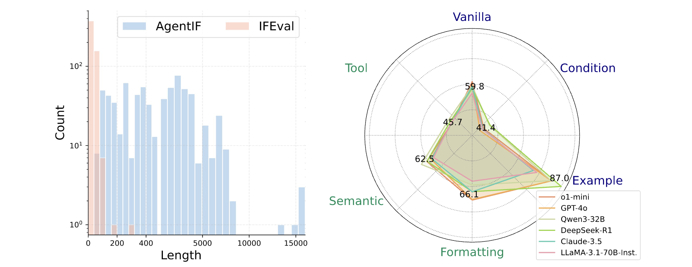
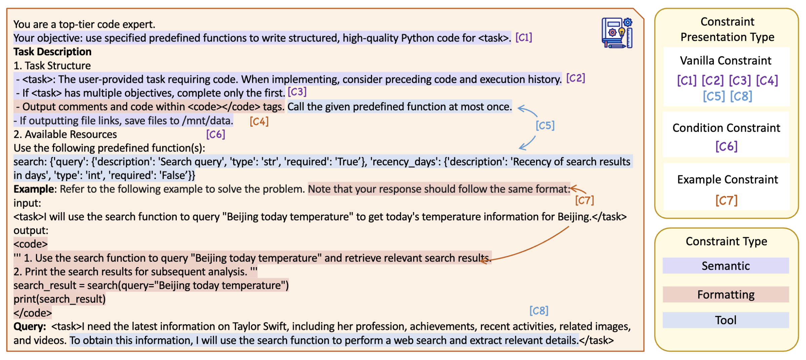
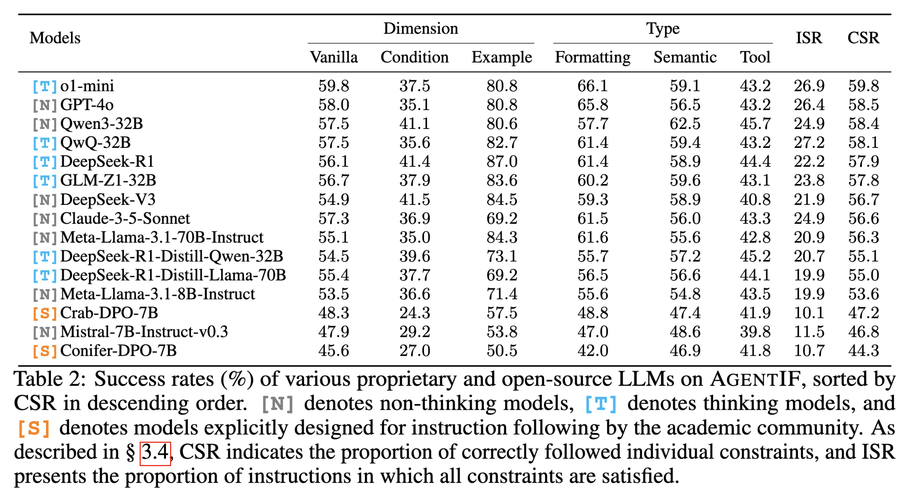

<p align="center">
    🌐 <a href="https://agentif.github.io" target="_blank">Project Page</a> • 
    📚 <a href="https://arxiv.org/abs/2505.16944" target="_blank">AgentIF Paper</a> • 
    📊 <a href="https://huggingface.co/datasets/THU-KEG/AgentIF" target="_blank">AgentIF Dataset</a>
</p>


---

We introduce **AgentIF**, the first benchmark for systematically **evaluating LLM instruction following ability in agentic scenarios**. AgentIF features three key characteristics: (1) **Realistic**, constructed from 50 real-world agentic applications. (2) **Long**, averaging 1,723 words with a maximum of 15,630 words. (3) **Complex**, averaging 11.9 constraints per instruction, covering diverse constraint types, such as tool specifications and condition constraints. Here is the instruction length distribution in AgentIF, along with the success rates of several representative LLMs across the constraint dimensions we propose:

An example instruction of AgentIF:


## News

- **2026-10 — Updated evaluation setting, fixed constraint checkers.** AgentIF now evaluates models in both thinking and non-thinking modes with their vendor-recommended decoding parameters, over 3 independent runs, judged by `gpt-5.6-luna`, through a config-driven pipeline (`run.sh` + `configs/`). We also fixed a number of constraint checkers in `data/eval.json`. See [Evaluation Setting](#evaluation-setting). Scores are not comparable with those of the original setting.

## Evaluation Setting

The original setting (`gpt-4o-2024-11-20` as the judge, greedy decoding with temperature 0 for the evaluated model, default mode only) no longer reflects how current models are released and used: vendors ship explicit thinking / non-thinking modes and recommended sampling parameters, and nobody deploys these models at temperature 0. To evaluate models the way they are actually used, we updated the setting as follows:

- **Judge model:** `gpt-5.6-luna` with temperature 1, `reasoning_effort=medium`, `max_completion_tokens=8192`. Every `llm` constraint is judged by it; `code` constraints run the annotated check function.
- **Modes:** models that support both thinking and non-thinking are evaluated in **both** modes and reported as separate rows (`chat_template_kwargs.enable_thinking` or the vendor's own switch).
- **Decoding:** the **vendor-recommended sampling parameters** of each model and mode (temperature, top_p, top_k, min_p, presence / repetition penalty). When the vendor gives none: thinking `T=1.0, top_p=0.95`; non-thinking `T=0.0, top_p=0.95`.
- **Output budget:** 32768 tokens in thinking mode, 16384 in non-thinking mode, trimmed automatically when prompt + budget exceeds the model's context window.
- **Runs:** 3 independent samples per (model, mode); we report mean ± sample std.
- **Empty or failed responses** are scored as an empty response (every constraint fails); nothing is dropped.

The exact parameters of every evaluated model are the committed `configs/<model>.yaml` files; the judge parameters are in `judge_configs/gpt-5.6-luna.yaml`.

**Constraint fixes.** Together with the new setting we fixed a number of constraint checkers in `data/eval.json` (code checks with logic errors that could never pass, and tool-call constraints that now count one constraint per tool and are marked *not applicable* instead of failed when the tool is not invoked). Re-scoring with the fixed data did not change the model ranking or the conclusions of the paper. Please use the current `data/eval.json`.

## Leaderboard

#### Metrics
- **Constraint Success Rate (CSR)** measures the proportion of individual constraints that are correctly satisfied by the model's response.
- **Instruction Success Rate (ISR)** measures the proportion of instructions for which all constraints are satisfied.

> The table below shows the top 10 of the 39 (model, mode) entries evaluated so far (open-weight models from 2B to 31B and several proprietary API models). The full leaderboard is at **https://agentif.github.io/**; more models will be added.

#### Current setting

Judge `gpt-5.6-luna`; every (model, mode) is sampled 3 times independently with the vendor-recommended decoding parameters (see `configs/<model>.yaml`). `[T]` = thinking mode, `[N]` = non-thinking mode. ISR and CSR are mean ± sample std over the 3 runs (sorted by ISR); the remaining columns are the mean CSR per constraint presentation type (Vanilla / Condition / Example) and per constraint type (Formatting / Semantic / Tool).

| # | Model | ISR (%) | CSR (%) | Vanilla | Condition | Example | Formatting | Semantic | Tool |
|---|---|---|---|---|---|---|---|---|---|
| 1 | [T] Qwen3.8-27B | 31.35 ± 0.36 | 65.77 ± 0.41 | 66.98 | 49.03 | 77.37 | 69.38 | 67.15 | 51.93 |
| 2 | [T] deepseek-v4-pro | 31.27 ± 1.54 | 67.44 ± 0.59 | 67.94 | 51.76 | 82.24 | 72.79 | 67.85 | 53.38 |
| 3 | [T] Qwen3.5-9B | 30.36 ± 0.59 | 65.33 ± 0.26 | 66.73 | 48.50 | 76.38 | 69.42 | 65.60 | 53.80 |
| 4 | [T] gemma-4-31B-it | 29.80 ± 0.33 | 64.79 ± 0.42 | 64.57 | 51.29 | 82.12 | 68.89 | 66.11 | 50.66 |
| 5 | [N] qwen3.8-flash | 29.56 ± 0.51 | 63.39 ± 1.22 | 64.12 | 49.34 | 74.92 | 72.61 | 60.87 | 51.92 |
| 6 | [T] granite-4.2-3b | 28.95 ± 1.66 | 58.78 ± 0.55 | 62.99 | 39.42 | 53.01 | 60.23 | 58.92 | 53.43 |
| 7 | [T] gemma-nemotron-4b-bf16-ea | 28.34 ± 0.86 | 62.07 ± 0.15 | 62.60 | 48.25 | 75.22 | 65.31 | 63.03 | 52.19 |
| 8 | [T] gemma-4-12B-it | 27.82 ± 0.64 | 63.16 ± 0.26 | 64.55 | 50.66 | 68.99 | 64.15 | 65.60 | 52.86 |
| 9 | [T] qwen3.8-flash | 27.35 ± 0.22 | 65.59 ± 0.59 | 66.03 | 49.89 | 80.80 | 71.82 | 66.18 | 51.13 |
| 10 | [T] glm-5.3 | 27.06 ± 1.04 | 64.21 ± 0.26 | 65.91 | 45.39 | 73.95 | 66.45 | 67.25 | 47.18 |

The exact vLLM flags, API endpoints and sampling parameters of every row are the committed `configs/<model>.yaml` files.

#### Legacy results — original setting

Produced with the original protocol: judge `gpt-4o-2024-11-20` with temperature 0, one greedy run per model, API models called with their default mode. Kept for reference only; not comparable with the table above.

Performance across constraint categories reported in the paper (original setting):



## Quick Start

### 1. Install

```bash
git clone https://github.com/THU-KEG/AgentIF.git && cd AgentIF
pip install -r requirements.txt            # openai, pyyaml, requests, tqdm, ...
pip install vllm                           # only for locally served models (vLLM >= 0.26 for the models in configs/)
```

The dataset (`data/eval.json`, 707 instructions) is included; `data/smoke/eval.json` holds 5 instructions for a quick test.

### 2. Configure

```bash
cp .env.example .env     # OPENAI_API_KEY (judge), optional OPENAI_BASE_URL, MODELS_DIR (local weights)
```

Pick or add a model config in `configs/`:

- **Local model (vLLM)** — copy one of the shipped configs (e.g. `configs/Qwen3.5-4B.yaml`). Required keys: `model_path` (use `${MODELS_DIR}/<name>` or an absolute path / HF repo id), `max_model_len`, `modes`. `vllm_args` are passed to `vllm serve` verbatim; `served_model_name`, `tensor_parallel_size`, `num_gpus`, `gpus`, `port` are optional.
- **API model** — copy `configs/api-model.example.yaml` to `configs/<name>.yaml`, set `api.base_url` / `api.model`, put the key in the environment variable named by `api.api_key_env`.
- Each entry under `modes` is evaluated separately with its own sampling parameters. Use `enable_thinking: true/false` for models that support `chat_template_kwargs`, or `extra_body` for vendor-specific switches. Single-mode models list one mode only.

Global behaviour (GPU pool, number of repeats, default judge, concurrency) lives in `configs/global.yaml`; judge endpoints and parameters in `judge_configs/`. See [`configs/README.md`](configs/README.md) for minimal templates, the full field reference and the conventions used for the leaderboard.

### 3. Run

```bash
bash run.sh --list                                                       # show configs
bash run.sh --models Qwen3.5-4B --repeats 1 --input-dir data/smoke --results-root results_smoke   # smoke test
bash run.sh --models Qwen3.5-4B                                          # full benchmark for one model
nohup bash run.sh > logs/run.out 2>&1 &                                  # every enabled config
bash run.sh --stage prediction                                           # predictions only
bash run.sh --stage evaluation                                           # judge existing predictions (no GPU)
bash run.sh --judge gpt-4o-2024-11-20                                    # another judge (judge_configs/<name>.yaml)
```

For every model the pipeline starts vLLM (GPUs are taken from the pool, models run in parallel when the pool allows), runs all (mode × run) predictions concurrently, stops vLLM as soon as the predictions are done, and judges on the API. Finished jobs are detected by their `accuracy.json`, and an interrupted judge job resumes from its `results.partial.jsonl`, so re-running the same command continues where it stopped.

### 4. Results

```
results/
  prediction/<model>__<mode>/run<N>/eval.json          # model responses + run_config.json (exact sampling parameters)
  scores/<model>__<mode>/run<N>_<judge>/eval/
      results.json                                      # per-constraint scores, judge outputs, null_reason
      accuracy.json                                     # CSR, ISR, breakdowns by presentation type / constraint type, failure_stats
  summary.md / summary.json                             # mean ± std over runs for every (model, mode, judge)
  run_metadata/<model>/run_metadata_<time>.json         # full config snapshot, vLLM version, job status
logs/                                                   # vLLM, prediction and evaluation logs
```

`python code4eval/aggregate.py` rebuilds `results/summary.*`; `python code4eval/1.evaluation_api.py --score_only --input_file <results.json>` recomputes an `accuracy.json` without calling the judge.

### Running the scripts directly

`run.sh` is a thin wrapper around `code4eval/batch_eval.py`. The two stages can also be called by hand against any OpenAI-compatible endpoint:

```bash
python code4eval/0.prediction_api.py --input_dir data/ --output_dir results/prediction/<model>__thinking/run1 \
    --llm_backbone <served_model_name> --llm_url http://127.0.0.1:8000/v1 --api_key EMPTY \
    --temperature 1.0 --top_p 0.95 --max_tokens 32768 --enable_thinking true --no_cache
python code4eval/1.evaluation_api.py --input_file results/prediction/<model>__thinking/run1/eval.json \
    --output_dir results/scores/<model>__thinking/run1_gpt-5.6-luna --reference_file data/eval.json \
    --llm_backbone gpt-5.6-luna --llm_url https://api.openai.com/v1 --api_key $OPENAI_API_KEY \
    --temperature 1.0 --reasoning_effort medium --max_tokens 8192
```

## Data Format
Each data instance in AgentIF is structured as follows:
```
{
  "input": [
    { "role": "system", "content": "..." },
    { "role": "user",   "content": "..." }
  ],
  "constraints": [
    {
      "id": 0,
      "desc": "...",                // Constraint description
      "other_info": {               // Auxiliary information for evaluation
        "...": "..."
      },
      "dimension": "...",           // Constraint Presentation Type
      "type": "...",                // Constraint Type
      "is_meta": false,             // Whether it is a meta-constraint
      "evaluation": [               // Evaluation Method
        {
          "type": "llm",            // LLM-based evaluation
          "required_keys": ["response"],
          "exec": "..."             // Evaluation prompt for LLM
        },
        {
          "type": "code",           // Code-based evaluation
          "exec": "..."             // Executable code snippet
        }
      ]
    }
  ]
}
```

## Citation

```
@misc{qi2025agentifbenchmarkinginstructionfollowing,
      title={AGENTIF: Benchmarking Instruction Following of Large Language Models in Agentic Scenarios}, 
      author={Yunjia Qi and Hao Peng and Xiaozhi Wang and Amy Xin and Youfeng Liu and Bin Xu and Lei Hou and Juanzi Li},
      year={2025},
      eprint={2505.16944},
      archivePrefix={arXiv},
      primaryClass={cs.AI},
      url={https://arxiv.org/abs/2505.16944}, 
}
```
